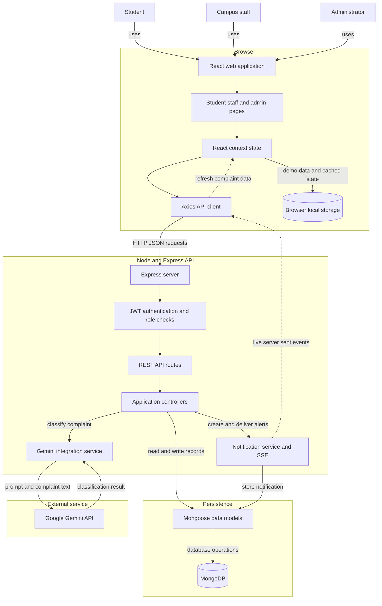

# Architecture Diagram

CampusResolve AI is a role-based campus complaint management application. Students report and track issues, administrators review and assign them, and staff update the work through to resolution.

## Application Architecture

<!-- mermaid-checked: no \n, no em-dash/en-dash, no {} in labels, subgraphs are id["label"], arrows are -->|"label"|, all subgraphs closed by end, ids unique -->

### Technology Stack Summary

| Layer | Technology | Version | Purpose |
|---|---|---|---|
| Frontend | React | `^19.2.8` in package manifest | Builds the role-based single-page application |
| Frontend routing | React Router DOM | `^7.18.3` in package manifest | Routes users to public and protected pages |
| Frontend styling | Tailwind CSS | `^3.4.19` in package manifest | Styles responsive screens and forms |
| Frontend API | Axios | `^1.20.0` in package manifest | Sends API requests and attaches the session token |
| Backend | Node.js and Express | Express `^5.2.1` in package manifest | Exposes REST endpoints and runs application logic |
| Authentication | JSON Web Token and bcryptjs | JWT `^9.0.3`; bcryptjs `^3.0.3` | Authenticates requests and hashes account passwords |
| Data access | Mongoose | `^9.9.4` in package manifest | Defines models and reads or writes MongoDB documents |
| Database | MongoDB | Server version is environment-dependent | Stores users, complaints, and notifications |
| AI integration | Google Gemini API | Model configurable by server environment | Checks complaint relevance and predicts a campus issue category |
| Live updates | Server-Sent Events | Built into the Express application | Pushes in-app notifications to connected users |
| Demo persistence | Browser local storage | Browser-provided | Caches app state and supports local demo behavior when the API is unavailable |

### Data Storage & External Services

MongoDB stores persistent user, complaint, and notification records through Mongoose. The frontend also uses browser local storage for session information and demo or cached data; this is a fallback path and is not the authoritative database. The backend calls the Google Gemini API to classify complaints and assess whether they relate to campus issues. Express streams in-app notifications to connected clients using Server-Sent Events.

### Key Architectural Decisions

- The application separates the React client, Express REST API, and MongoDB persistence into distinct layers.
- JWT authentication and role checks protect API routes and frontend pages for students, staff, and administrators.
- Complaint notifications are persisted and also delivered live over Server-Sent Events; local storage supports a limited demo fallback.

## Component Relationships

```mermaid
flowchart LR
    subgraph cPresentation["Presentation"]
        cPages["Role based React pages"]
        cSharedUi["Shared UI components"]
        cRouteGuard["Protected route guard"]
    end

    subgraph cClientState["Client state and API"]
        cAuthContext["Auth context"]
        cComplaintContext["Complaint context"]
        cNotificationContext["Notification context"]
        cAxios["Axios API service"]
        cLocalStorage[("Browser local storage")]
    end

    subgraph cBackendApi["Backend API"]
        cExpress["Express application"]
        cJwt["JWT auth and role middleware"]
        cRoutes["Auth complaint AI and notification routes"]
        cAuthController["Authentication controller"]
        cComplaintController["Complaint controller"]
        cAiController["AI controller"]
        cNotificationController["Notification controller"]
    end

    subgraph cServices["Backend services"]
        cGeminiService["Gemini service"]
        cNotificationService["Notification service and SSE"]
    end

    subgraph cData["Data access"]
        cUserModel["User model"]
        cComplaintModel["Complaint model"]
        cNotificationModel["Notification model"]
        cMongo[("MongoDB")]
    end

    cPages -->|"renders"| cSharedUi
    cPages -->|"reads user and role"| cAuthContext
    cPages -->|"reads and updates tickets"| cComplaintContext
    cPages -->|"shows alerts"| cNotificationContext
    cRouteGuard -->|"checks signed in role"| cAuthContext
    cAuthContext -->|"persists demo and session state"| cLocalStorage
    cComplaintContext -->|"persists cache and demo state"| cLocalStorage
    cAuthContext -->|"login and registration requests"| cAxios
    cComplaintContext -->|"complaint requests"| cAxios
    cNotificationContext -->|"notification requests and event stream"| cAxios
    cAxios -->|"REST and SSE"| cExpress
    cExpress -->|"routes requests through"| cJwt
    cJwt --> cRoutes
    cRoutes --> cAuthController
    cRoutes --> cComplaintController
    cRoutes --> cAiController
    cRoutes --> cNotificationController
    cAuthController -->|"account lookup and save"| cUserModel
    cComplaintController -->|"ticket and staff lookup"| cUserModel
    cComplaintController -->|"ticket workflow"| cComplaintModel
    cComplaintController -->|"classifies complaint"| cGeminiService
    cAiController -->|"classifies complaint"| cGeminiService
    cComplaintController -->|"publishes alerts"| cNotificationService
    cNotificationController -->|"streams live alerts"| cNotificationService
    cNotificationService -->|"saves alerts"| cNotificationModel
    cUserModel --> cMongo
    cComplaintModel --> cMongo
    cNotificationModel --> cMongo
```

<!-- mermaid-checked: no \n, no em-dash/en-dash, no {} in labels, subgraphs are id["label"], arrows are -->|"label"|, all subgraphs closed by end, ids unique -->

### Component Inventory

| Component | Layer | Type | Responsibility |
|---|---|---|---|
| Role-based React pages | Presentation | Pages | Provide public, student, staff, and administrator screens |
| Shared UI components | Presentation | Components | Reuse layouts, forms, complaint cards, dialogs, and status displays |
| Protected route guard | Presentation | Route guard | Redirects unauthenticated users and blocks routes outside their role |
| Auth context | Client state | React context | Handles sign-in, registration, logout, current user, and role state |
| Complaint context | Client state | React context | Loads and updates complaints and staff, with local demo persistence |
| Notification context | Client state | React context | Loads notifications, tracks read state, and consumes live events |
| Axios API service | Client integration | HTTP client | Sends JSON requests to the configured API and attaches the JWT |
| Express application | Backend | Server | Configures middleware, mounts API routes, and handles errors |
| JWT auth and role middleware | Backend cross-cutting | Middleware | Verifies bearer tokens and restricts protected endpoints by role |
| Auth routes and controller | Backend | Routes and controller | Registers accounts, signs users in, and returns account information |
| Complaint routes and controller | Backend | Routes and controller | Creates, lists, reviews, assigns, and updates complaint records |
| AI route and controller | Backend | Routes and controller | Validates and rate-limits requests for complaint analysis |
| Notification routes and controller | Backend | Routes and controller | Lists notifications, opens the event stream, and updates read status |
| Gemini service | Backend integration | Service | Calls Gemini and validates the complaint classification response |
| Notification service and SSE | Backend integration | Service | Persists notifications and pushes events to connected users |
| User model | Data access | Mongoose model | Stores account identity, role, department, and staff information |
| Complaint model | Data access | Mongoose model | Stores complaint details, status timeline, assignment, remarks, and feedback |
| Notification model | Data access | Mongoose model | Stores notification recipients, content, timestamps, and read state |
| MongoDB | Data storage | Document database | Persists application records |

## PPT-Ready Project Flow

### Suggested slide sequence

1. **Project overview** - CampusResolve AI brings students, campus staff, and administrators into one complaint-management workflow.
2. **Technology architecture** - Show the application architecture diagram: React client, Express API, MongoDB, Gemini, and notifications.
3. **Sign-in and access control** - Users register or sign in; the server issues a JWT, and role-based guards show the appropriate portal.
4. **Complaint submission** - A student describes the issue and location. The client suggests a category, while the backend checks and classifies the submitted complaint with Gemini.
5. **Administrator review and assignment** - New complaints enter Pending Review. An administrator approves or rejects them; approved complaints can be assigned to an active staff member.
6. **Staff resolution and student tracking** - Assigned staff work on the complaint and update its progress. Students can track complaint status and history.
7. **Notifications and data** - MongoDB stores the records; in-app notifications are saved and pushed live to connected users through Server-Sent Events.
8. **Conclusion** - The system provides a traceable route from campus issue reporting through administrator decisions and staff resolution.

### Presenter talk track

“A student signs in and submits a campus issue with its location. CampusResolve AI suggests a category and the backend uses Gemini to check the complaint and determine its category. The complaint is stored in MongoDB with a Pending Review status. An administrator reviews it and, if approved, assigns it to an active staff member. Staff update the work as it progresses, while the student follows the status and receives notifications. React provides the role-specific screens, Express handles API requests and access checks, and MongoDB stores the application records.”

### Complaint lifecycle

`Submitted -> Pending Review -> Approved -> Assigned -> In Progress -> Resolved -> Verified`

An administrator may reject a complaint during review. Actual transitions depend on the user role and complaint state.
